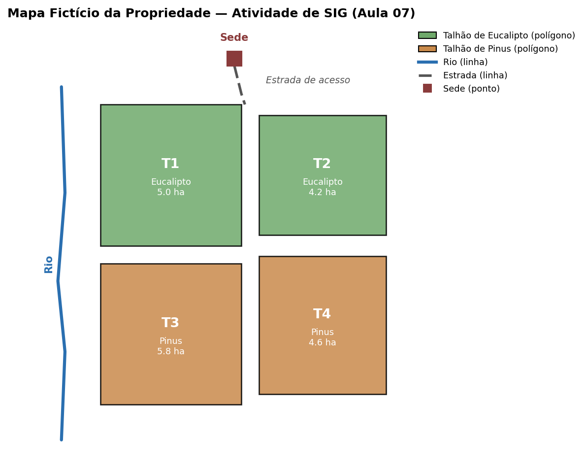

## Atividade — Organizando a Propriedade em Camadas de SIG

Esta atividade é **conceitual**: não é preciso instalar QGIS nem nenhum
outro software. O objetivo é praticar como se pensa a organização de dados
dentro de um SIG, a partir de um mapa fictício da mesma propriedade usada
nas atividades anteriores.

**Objetivo:** aplicar os conceitos de dado vetorial/raster, camadas e
tabela de atributos a um cenário concreto.

### O que fazer

1. **Classifique** cada elemento do mapa como dado **vetorial** (e, nesse
   caso, se é ponto, linha ou polígono) ou **raster**: os talhões, a
   sede, a estrada e o rio.
2. **Proponha a lista de camadas** (layers) que comporiam este SIG,
   indicando a ordem de sobreposição (da camada de fundo até a de cima).
3. **Monte a tabela de atributos** da camada de talhões — os mesmos
   campos da atividade da Aula 04 (`TalhaoID`, Espécie, Área), agora
   associados a um polígono no mapa.
4. **Responda**, usando os dados do mapa:
   a) Qual a área total ocupada por Eucalipto, e qual por Pinus?
   b) Olhando o mapa, qual talhão fica mais próximo da sede? Como essa
      informação poderia influenciar o planejamento de colheita ou
      transporte?
5. **Questão conceitual:** por que organizar essas informações em um SIG
   traz vantagem em relação a manter só uma planilha ou um banco de dados
   comum (sem a localização espacial)?

**Entrega:** um documento (PDF ou texto) com a classificação, a lista de
camadas, a tabela de atributos e as respostas das perguntas 4 e 5.
<!-- TODO: definir e preencher a data de entrega -->
