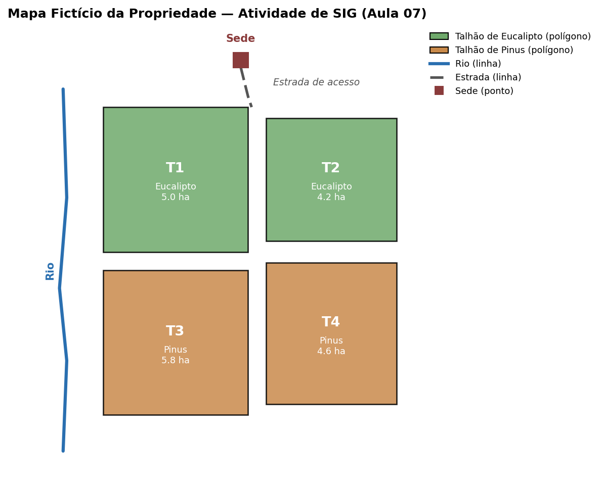

**Disciplina:** Informática Aplicada à Engenharia Florestal — UFAL, Campus CECA

**Docente:** Prof. Davy Baia

**Formato:** trabalho em **grupo de 4 integrantes**

**Valor total:** 9,0 pontos

## Instruções Gerais

Esta atividade deve ser realizada em **grupos de 4 integrantes** (os
mesmos da Atividade Avaliativa 1, salvo reorganização prévia combinada com
o docente) e cobre o conteúdo das Aulas 04 a 07. É composta por 4 tarefas
exclusivamente práticas — cada uma produz um arquivo de evidência que deve
ser entregue ao final.

- Use o programa de sua preferência em cada etapa (Windows, macOS ou
  Linux; Microsoft Office, LibreOffice, Google Workspace ou equivalente).
- As tarefas reaproveitam os dados da propriedade (sede + talhões T1 a T4)
  usados nas atividades das próprias aulas — revisem o material de cada
  aula antes de começar.
- Nomeiem os arquivos exatamente como indicado em cada tarefa — isso
  facilita a correção.
- Identifiquem os 4 integrantes do grupo (nome completo e matrícula) na
  capa dos relatórios em PDF (Tarefas 2, 3 e 4).
- A Tarefa 1 vale 1,5 ponto; as Tarefas 2, 3 e 4 valem 2,5 pontos cada.

## Tarefa 1 — Banco de Talhões e Medições

**Tema:** Banco de Dados (Aula 04) · **Valor:** 1,5 ponto

Simulem um pequeno banco de dados relacional em planilha eletrônica, com
as abas da planilha fazendo o papel de tabelas:

1. Aba **Talhoes** (chave primária `TalhaoID`):

   | TalhaoID | Área (ha) | Produção (m³) |
   |:--------:|:---------:|:--------------:|
   | T1 | 5,0 | 12,5 |
   | T2 | 4,2 | 9,8 |
   | T3 | 5,8 | 14,2 |
   | T4 | 4,6 | 11,0 |

2. Aba **Medicoes**, com duas medições de campo por talhão (`MedicaoID`,
   `TalhaoID`, Data, DAP, Altura) — `TalhaoID` é a chave estrangeira,
   referenciando a aba Talhoes.
3. Na aba Medicoes, criem uma coluna **Produção do Talhão (m³)** que busca
   o valor na aba Talhoes usando `PROCV`/`VLOOKUP` a partir do `TalhaoID`
   — sem digitar o valor manualmente.
4. Respondam, em uma terceira aba ou documento à parte:
   a) Qual é a chave primária de cada aba, e qual a chave estrangeira?
   b) Que tipo de relacionamento existe entre Talhoes e Medicoes (1:1,
      1:N ou N:N)? Justifiquem.
   c) O que um SGBD de verdade (Access, LibreOffice Base) faria de
      diferente da planilha se alguém tentasse cadastrar uma medição com
      um `TalhaoID` inexistente?

**Entregável:** arquivo `banco_talhoes_medicoes.xlsx` (ou `.ods`), com as
duas abas, a fórmula `PROCV` visível e as respostas do item 4.

## Tarefa 2 — Projeto de Rede Rural

**Tema:** Redes de Computadores e Internet (Aula 05) · **Valor:** 2,5 pontos

Projetem a rede da mesma propriedade (sede + talhões T1 a T4):

1. Escolham e justifiquem o tipo de conectividade da sede com a internet
   (satélite, rádio ou 4G/5G rural).
2. Desenhem um diagrama (à mão fotografado, ou em qualquer ferramenta)
   mostrando: a sede (modem/roteador + Access Point + computador/tablet),
   a conexão com a internet, e um sensor de campo em cada talhão
   conectado à sede por uma rede de baixo consumo (ex.: LoRa).
3. Identifiquem a topologia usada (estrela, barramento ou malha) e
   justifiquem.
4. Montem uma tabela com cada dispositivo do diagrama, o tipo de conexão
   (cabeada/sem fio) e sua função.
5. Respondam: por que a conexão com a internet é uma WAN e a rede interna
   da propriedade é uma LAN? Por que usar uma rede de baixo consumo para
   os sensores dos talhões, em vez de Wi-Fi comum?

**Entregável:** arquivo `projeto_rede_rural.pdf`, contendo o diagrama, a
tabela de dispositivos e as respostas do item 5.

## Tarefa 3 — Plano de Gestão Integrada

**Tema:** Informática na Propriedade Rural (Aula 06) · **Valor:** 2,5 pontos

Escrevam um relatório curto (1 a 2 páginas), aplicando as boas práticas de
formatação da Aula 02 (estilos de título, não formatação manual), com um
parágrafo para cada item:

1. **Sistema Operacional** — como organizar os arquivos da propriedade no
   computador da sede.
2. **Processador de Texto** — quais documentos a propriedade produziria
   regularmente, e por quê.
3. **Planilha Eletrônica** — quais controles seriam mantidos em planilha
   e que decisões eles ajudam a tomar.
4. **Banco de Dados** — que cadastros fariam sentido ter em um banco de
   dados (reaproveitem o banco da Tarefa 1) e por que não bastaria uma
   planilha simples.
5. **Redes** — como a rede projetada na Tarefa 2 ajudaria no dia a dia da
   gestão.
6. **Tendência (Agro 4.0)** — escolham **uma** tendência (IoT, drones,
   integração de dados) e expliquem como ela poderia melhorar a gestão
   dessa propriedade específica.

**Entregável:** arquivo `plano_gestao_integrada.pdf`.

## Tarefa 4 — Organização da Propriedade em SIG

**Tema:** Noções de Sistemas de Informação Geográfica (Aula 07) · **Valor:** 2,5 pontos

A partir do mapa acima:

1. Classifiquem cada elemento (talhões, sede, estrada, rio) como dado
   **vetorial** (ponto, linha ou polígono) ou **raster**.
2. Proponham a lista de camadas (layers) que comporiam este SIG, da
   camada de fundo até a de cima.
3. Montem a tabela de atributos da camada de talhões (`TalhaoID`,
   Espécie, Área) — os mesmos campos da aba Talhoes da Tarefa 1, agora
   associados a um polígono no mapa.
4. Respondam, usando os dados do mapa:
   a) Qual a área total ocupada por Eucalipto, e qual por Pinus?
   b) Qual talhão fica mais próximo da sede, e como isso poderia
      influenciar o planejamento de colheita ou transporte?
5. Respondam: por que organizar essas informações em um SIG traz
   vantagem em relação a manter só uma planilha ou um banco de dados
   comum (sem a localização espacial)?

**Entregável:** arquivo `sig_propriedade.pdf`, com a classificação, a
lista de camadas, a tabela de atributos e as respostas dos itens 4 e 5.

## Entrega Final

Compactem todos os arquivos pedidos em uma única pasta `.zip`, nomeada
`AtividadeAvaliativa2.zip`, contendo:

- `banco_talhoes_medicoes.xlsx`
- `projeto_rede_rural.pdf`
- `plano_gestao_integrada.pdf`
- `sig_propriedade.pdf`

**Prazo:** 23 de novembro de 2026, até às 23:59.

**Discussão presencial:** é imprescindível a presença de todos os
integrantes do grupo no dia **24 de novembro de 2026** para a etapa de
discussão presencial do trabalho.

**Modalidade:** entrega via e-mail: davy.baia@ceca.ufal.br

**Assunto:** [2026.2.IEF] - Trabalho Avaliativo 02.

**Corpo do e-mail:** Nomes dos integrantes em ordem alfabética.
